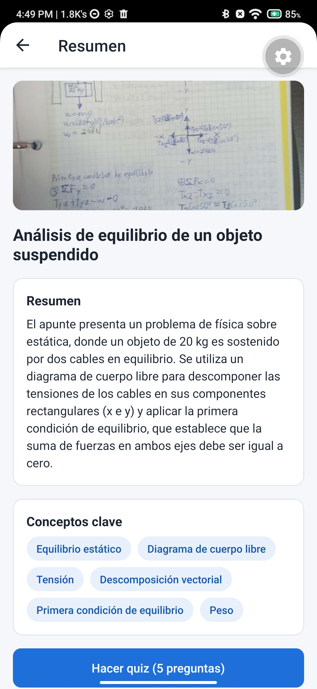
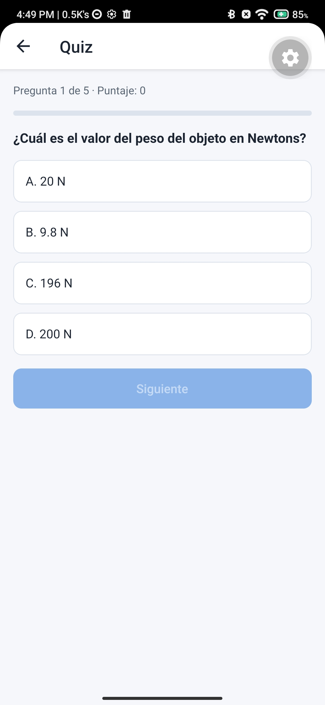
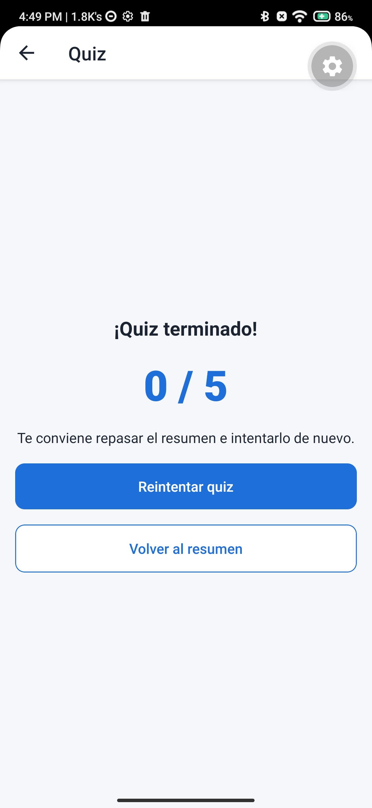

## React-camera
Es una app pensada para ayudar a los estudiantes a repasar o conocer un resumen de sus notas. Su funcionamiento se basa en tomar o elegir una fotografia y mediante Gemini AI (API) realizar un resumen y puntos destacados de su apunte. Ademas permite realizar un quiz de 5 preguntas para reforzar el tema.

## Capturas de pantalla





# Propmt usado
```
Necesito que trabajemos con la implementacion de lo sigueinte:
Instala las dependencias:
npx expo install @react-native-firebase/app @react-native-firebase/ai @react-native-firebase/app-check expo-build-properties expo-image-picker expo-sqlite expo-dev-client
Después agrega los plugins correspondientes en app.json.
Genera el development build con npx expo run:android o con EAS Build, e instálalo en tu dispositivo. A partir de aquí ya no usarás Expo Go.
Pantalla de captura. Agrega los botones “Tomar foto” (launchCameraAsync) y “Elegir de galería” (launchImageLibraryAsync), activa la opción base64: true y muestra una vista previa con <Image>.
Escribe el prompt. Debe pedir que la respuesta sea solo JSON:
{ "titulo": "", "resumen": "", "conceptos_clave": [], "preguntas": [ { "pregunta": "", "opciones": [], "correcta": 0 } ] }
Pide 5 preguntas de opción múltiple. Para el reto extra, define la estructura con responseSchema.
Llama a Gemini. Crea el modelo con getGenerativeModel y envía el texto del prompt junto con la imagen como inlineData (con mimeType y la cadena base64). Mientras llega la respuesta, muestra un ActivityIndicator y deshabilita los botones.
Procesa la respuesta. Aplica JSON.parse dentro de un try/catch. Si falla, muestra un mensaje amigable y no dejes que la app se cierre.
Navegación. Con Expo Router, crea tres pantallas: Resumen (título, resumen y conceptos clave), Quiz (una pregunta a la vez, con retroalimentación y puntaje al final) e Historial.
Manejo de errores. Prueba estos casos: sin internet, permisos de cámara denegados, cancelar la cámara, y una foto borrosa o que no sea un apunte.
Ignora el punto 4. Ya genere el build. Hasta ahora la app solo toma la fotografia y la guarda en galeria, la idea es que se tome una fotografia o se seleccione una de la galeria y que se mande a gemini para que retorne un json. La idea de la app es que sea una app que le mandes una fotografia y te de en texto un resumen. por esto es que le decimos que la respuesta de gemini debe de ser un JSON con ese formato.
```

> Se redacto asi para que la IA tenga el contexto necesario para contruir la app.

# Pasos para generar el dev build
## 1. Instala la CLI de EAS e inicia sesion
```
npm install -g eas-cli
eas login
```

## 2. Configurar el perfil de compilacion
```
eas build:configure
```

## 3. Iniciar compilacion en la nube de EAS
```
eas build --profile development --platform android
```

# Ejecucion de la app despues de crear la apk
## 1. Ejecuta el servidor desde terminal
```
npx expo start --dev-client
```